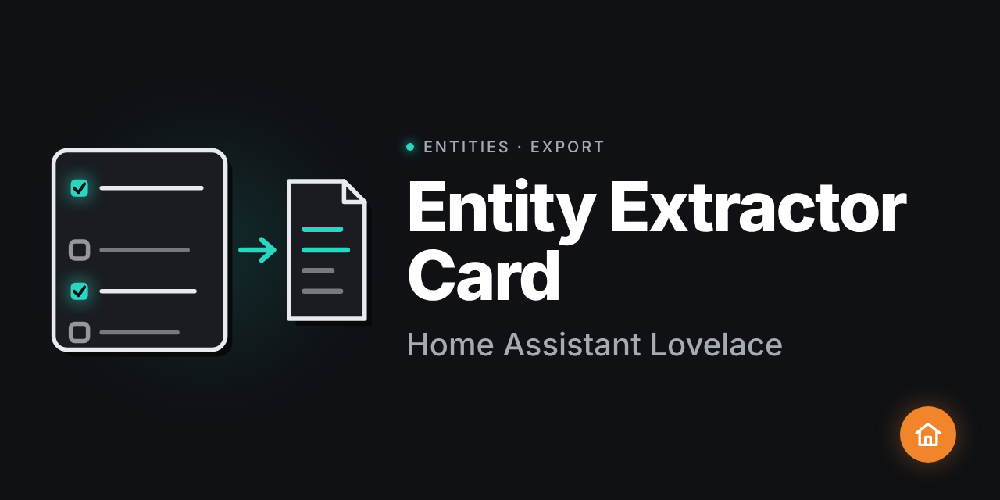
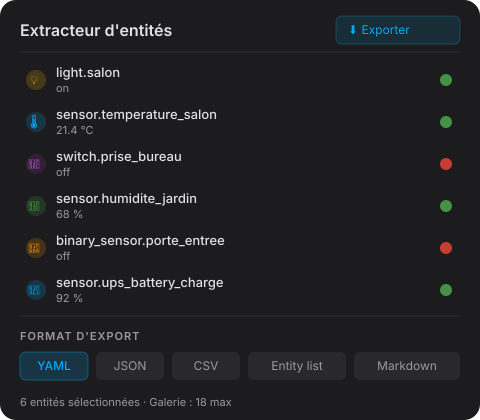

# Entity Extractor Card



[](https://github.com/hacs/integration)

Carte Lovelace Home Assistant pour extraire et exporter les entités sous différents formats.



## Fonctionnalités

- Affichage d'une galerie jusqu'à 18 entités avec aperçu en direct
- Export en 5 formats : YAML, JSON, CSV, Entity list, Markdown table
- Filtrage par domaine, état, et attributs
- Interface de configuration visuelle dans l'éditeur Lovelace

## Installation via HACS

[](https://my.home-assistant.io/redirect/hacs_repository/?owner=HOMELAB-IA&repository=ha-entity-extractor-card&category=lovelace)

Ou manuellement :

1. Dans HACS, aller dans **Frontend** → **⋮** → **Dépôts personnalisés**
2. Ajouter `https://github.com/HOMELAB-IA/ha-entity-extractor-card` (catégorie : **Lovelace**)
3. Chercher **Entity Extractor Card** et cliquer **Télécharger**
4. Redémarrer Home Assistant si demandé

## Installation manuelle

1. Télécharger `entity-extractor-card.js` depuis la [dernière release](https://github.com/HOMELAB-IA/ha-entity-extractor-card/releases/latest)
2. Copier le fichier dans `/config/www/`
3. Dans **Paramètres** → **Tableau de bord** → **Ressources**, ajouter :
   - URL : `/local/entity-extractor-card.js`
   - Type : **Module JavaScript**

## Utilisation

```yaml
type: custom:entity-extractor-card
title: Extracteur d'entités
```

## Licence

MIT
